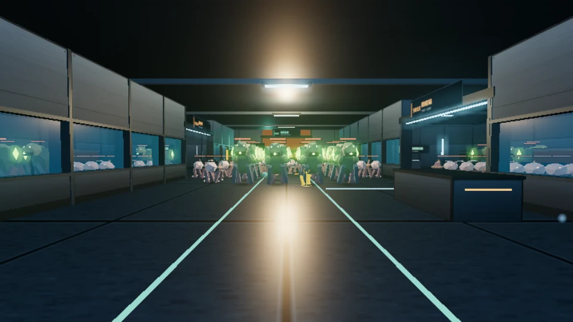
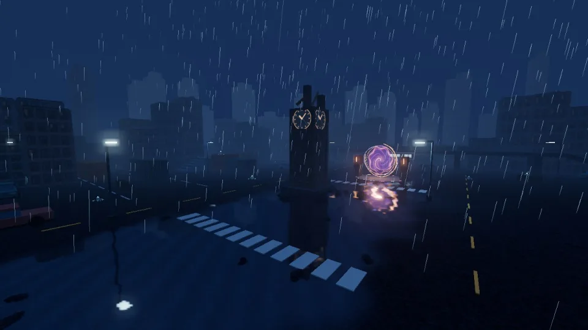
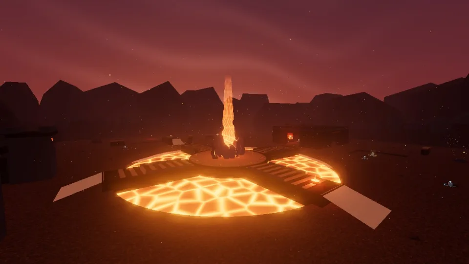
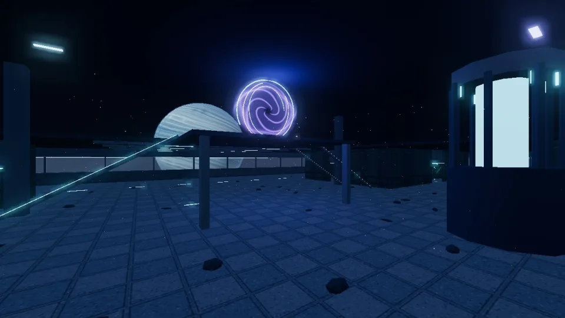
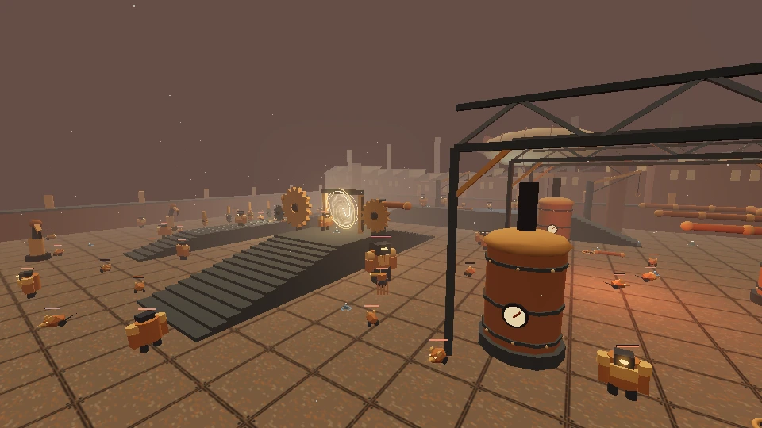

# 超级玩家

在线试玩已关闭。可按下方「快速开始」在本地游玩。


桌面浏览器上的第一人称走位射击单机战役，收录了多个主题关卡，数量还在持续增加。全部场景由基础几何体搭建、纹理程序化生成，不依赖任何外部模型和贴图，下载源码并生成关卡后即可离线游玩。

## 快速开始

本地开发使用 Node.js 24 和 Python 3。首次克隆后，在项目根目录安装构建依赖、生成关卡，再启动服务。

```sh
npm ci
npm run build
python3 server.py
```

用桌面浏览器打开 <http://127.0.0.1:8000/> 进入战役首页。服务只监听本机，默认存档写入 `.data/super-player.sqlite3`。

- 换端口：`python3 server.py --port 8080`
- 用其他存档文件（便于测试）：`python3 server.py --db /tmp/test.sqlite3`

## 玩法与存档

- **在线战役**：使用静态发布目录启动站点后，从首页进入。通关、战利品、对战记录和佩戴选择保存在当前浏览器的 IndexedDB 中。清除该站点数据会清除在线进度。

- **本机 SQLite 战役**：通过上面的本机服务进入首页，已发布的关卡按顺序解锁。成功撤离才会带回本局战利品并计入图鉴，失败保留对战记录但带回计为零。武器外观的佩戴也保存在同一份 SQLite 存档里。
- **单关离线**：直接双击任意关卡目录下的 `index.html`（例如 `rain-city/index.html`）即可开玩，适合练习。这种方式不写战役存档。各关卡通过相对路径引用 `level-kit/vendor/three-r160.js`，所以请保留仓库的目录结构。

## 操作

| 按键 | 动作 |
| --- | --- |
| 鼠标左键 | 朝准星方向射击 |
| `V` / `I` / `M` | 切换第一人称与肩后视角 / 检视武器计数器 / 切换音效 |
| `W` `A` `S` `D` | 移动 |
| `Shift` | 冲刺，消耗体力 |
| 空格 | 跳跃 |
| `R` | 提前换弹。打空弹匣且仍有备弹时会自动换弹 |
| `F` | 交互、开启机关、拾取关键物或引爆撤离 |
| `G` | 在提供深入路线的撤离点二次确认冒险深入 |
| `Q` / `E` | 使用两个主动技能槽 |
| `1` / `2` | 使用两个消耗道具槽 |
| `C` | 蹲伏（部分关卡用于压低声响） |
| `Esc` | 释放鼠标并暂停，点击画面可重新进入 |

进入游戏后可展开「装备选择与补给站」。撤离带出的宝物按价值计入军需点，可以兑换道具或永久枪械改装。出发时从库存领取已选道具，急救包和手雷各有一份免费配给。未用道具在撤离时入库，失败时丢失。

手雷默认装在道具二，按 `2` 朝准星方向投出。稍微抬高准星可以投得更远，低头可以投在脚边。手雷碰到墙体或掩体会落下，随后在所在位置爆炸。实体墙能挡住爆炸伤害。

首页「设置」可调整键位、灵敏度、视野、音量、难度、震动和画质。标准布局手柄使用双摇杆移动、瞄准，右扳机开火，肩键释放技能，方向键上下使用道具，Y 交互。首页「新的战役」创建独立存档，可在「存档」中切回。生成关卡后也可双击根目录的 `index.html` 游玩浏览器存档战役。

屏幕边缘的黄红三角提示附近凶兽，红弧指向刚刚打中你的方向。看到地面出现冲锋线时，可向侧面闪避。低血量时会听到心跳，画面边缘随之脉动。在设置中可以单独调低受击震动或关闭受击红弧。

## 关卡一览

| 序号 | 关卡 | 主题机制 |
| --- | --- | --- |
| 1 | 地下实验室 | 清理各区守卫、取证开门，穿过检修通道撤离 |
| 2 | 上古秘境 | 周期血月加成、岩浆灼伤、三座双向石桥 |
| 3 | 雨夜废城 | 钟楼坚守、布置炸药与限时起爆、突破封锁线 |
| 4 | 流沙王陵 | 沙暴封闭视野、循声追击、蹲伏压低声响 |
| 5 | 极夜冰站 | 体温量表、室外失温减速、室内与篝火回温 |
| 6 | 沉穹古都 | 在穹顶进水期间保护无人机，护送它抵达撤离区 |
| 7 | 烬火要塞 | 岩浆潮汐改变通路、燃烧地带、高桥环路 |
| 8 | 失压环站 | 舱段随机失压吸拽、天花板攀爬虫群、母体孵化 |
| 9 | 霓雨下城 | EMP 中断照明与 HUD、瘫痪机械敌人、无人机坠落爆炸 |
| 10 | 雨蚀天阶 | 雷雨涨水与伏击、毒镖中毒、解毒草定时重生 |
| 11 | 血月古堡 | 血月提升凶兽移速与伤害、圣露掉落、伯爵化蝠 |
| 12 | 樱落夜町 | 灯笼长街的百鬼队列、增援提速、灯笼妖补给 |
| 13 | 黄铜机坊 | 管道爆裂蒸汽、传送带、锅炉车间诱敌 |
| 14 | 永夜游园 | 失控旋转木马和过山车、气球爆炸、镜屋窄道 |
| 15 | 巴黎铁塔：高塔救援 | 登上观景台，启动救援信标，坚守 90 秒后登机 |

成功撤离后，可以在武器库中旋转查看并佩戴该关的步枪。外观与战斗特性一同装备，可带去其他关卡。与血月、蒸汽等场景事件联动的能力在对应环境中触发。

第一次进入可选择独立新手教程，也可以直接开始战役。首页可随时进入教程或无限备弹的火力试验场。战前面板说明所选行动的胜利条件，列出本局变奏、装备和补给。

按局内任务卡推进。实验室需逐区取证开门，钟楼坚守后要爆破突围，沉穹古都需要保护勘探无人机。上古秘境和樱落夜町还可选择追踪猎物。探索时可以挑战宝库、寻找秘闻，或利用场景机关牵制守卫。

「对战记录」能查看每局的战利品、武器表现、最高连杀和评级。在设置中开启「录制战术回放」，下一局的战报还可以回看路线、血量和关键事件。

## 关卡截图

下列画面均由关卡内程序生成，按战役解锁顺序排列（点击可查看大图）：

<table>
  <tr>
    <td align="center"><a href="campaign/images/underground-lab.webp"></a><br>地下实验室</td>
    <td align="center"><a href="campaign/images/shanhai-secret-realm.webp"></a><br>上古秘境</td>
    <td align="center"><a href="campaign/images/rain-city.webp"></a><br>雨夜废城</td>
  </tr>
  <tr>
    <td align="center"><a href="campaign/images/buried-tomb.webp"></a><br>流沙王陵</td>
    <td align="center"><a href="campaign/images/polar-station.webp"></a><br>极夜冰站</td>
    <td align="center"><a href="campaign/images/drowned-city.webp"></a><br>沉穹古都</td>
  </tr>
  <tr>
    <td align="center"><a href="campaign/images/ember-fortress.webp"></a><br>烬火要塞</td>
    <td align="center"><a href="campaign/images/derelict-station.webp"></a><br>失压环站</td>
    <td align="center"><a href="campaign/images/neon-undercity.webp"></a><br>霓雨下城</td>
  </tr>
  <tr>
    <td align="center"><a href="campaign/images/jungle-temple.webp"></a><br>雨蚀天阶</td>
    <td align="center"><a href="campaign/images/bloodmoon-castle.webp"></a><br>血月古堡</td>
    <td align="center"><a href="campaign/images/sakura-night-town.webp"></a><br>樱落夜町</td>
  </tr>
  <tr>
    <td align="center"><a href="campaign/images/brass-factory.webp"></a><br>黄铜机坊</td>
    <td align="center"><a href="campaign/images/haunted-midway.webp"></a><br>永夜游园</td>
    <td align="center"><a href="campaign/images/paris-tower.webp"></a><br>巴黎铁塔：高塔救援</td>
  </tr>
</table>

## 目录结构

```
index.html              战役首页
server.py               本机服务与 SQLite 存档
campaign/               首页资源、关卡登记表 levels.json、存档读写模块
level-kit/              共享关卡运行时、打包脚本、Three.js 本地依赖
level-kit/src/          输入、武器、碰撞寻路、凶兽、拾取、HUD、结算等公共模块
level-kit/starter/      新建关卡的灰盒模板
<关卡目录>/scene.mjs    该关的主题、地图数据与专属机制（源文件）
<关卡目录>/index.html   打包生成的可直接游玩入口
```

## 自己改关卡或加新关

需要 Node.js 18 或更高版本。

```sh
# 1. 复制灰盒模板，改 CONFIG、MAP_GRID 和主题文案
mkdir -p my-level && cp level-kit/starter/scene.mjs my-level/scene.mjs

# 2. 根目录起服务后预览
python3 server.py
# 浏览器访问 http://127.0.0.1:8000/level-kit/preview.html?scene=../my-level/scene.mjs

# 3. 生成独立可玩 HTML
node level-kit/pack.mjs my-level/scene.mjs
```

接入战役时在 `campaign/levels.json` 追加一条登记，并在 `campaign/images/` 放同名 WebP 预览图，然后重新打包受影响的关卡。完整的玩法约定、场景接口字段和验收清单见：

- [地图关卡开发圣经](LEVEL_BIBLE.md)：玩法规格、交付格式、难度曲线
- [关卡组件说明](level-kit/README.md)：新建关卡流程与 `scene.mjs` 的全部接口
- [关卡 UI 布局规范](level-kit/UI_LAYOUT.md)：共享 HUD 与状态位约定

## 许可证

项目采用 [MIT 许可证](LICENSE)。

## 构建与发布

`npm test` 运行核心模块测试。`npm run build` 重新生成所有关卡。使用 `npm run build -- dist` 可将纯静态站点写入新建的发布目录（命令会创建该目录），支持部署在仓库名子路径下。

GitHub Actions 在 PR 中验证 SQLite 战役和静态战役。当前公开站点仅发布下线提示。恢复试玩时，将仓库变量 `PAGES_DEMO_ENABLED` 设为 `true`，再从 `main` 运行工作流。

## 第三方声明

`level-kit/vendor/three-r160.js` 是本地打包的 [Three.js](https://threejs.org/) r160（MIT 许可），许可原文见 [level-kit/vendor/THREE-LICENSE.txt](level-kit/vendor/THREE-LICENSE.txt)。音效由 Web Audio 实时合成，无外部音频素材。

## 已知限制

- 面向桌面浏览器与鼠标键盘，未适配移动端和触屏。
- 浏览器战役和本机 SQLite 战役各自保存进度。
- 同屏超过 80 只凶兽时以 60 fps 为验收目标，实际帧率取决于设备。
